# 🚿 趣智Lite (QuzhiLite)

[](https://developer.android.com)
[](https://kotlinlang.org)
[](https://developer.android.com/jetpack/compose)
[](https://github.com/shierpuzi/linyu/releases/latest)
[](LICENSE)

**⬇️ [下载最新 APK (v3.2.2)](https://github.com/shierpuzi/linyu/releases/latest)**

> 正式版 `com.quzhi.lite`：**12.77 MB**（R8 混淆 + 资源压缩），仅支持 64 位（arm64-v8a）设备。
>
> v3.2.1 起正式版使用**真正的 release 签名**（不再是 debug 签名）。证书 SHA-256 指纹
> `81:7F:13:F0:56:B0:08:1F:...` 可以在 [SECURITY.md](docs/SECURITY.md) 第二节里核对（含验证命令）。
>
> ⚠️ 但请听清这句话：**签名只能证明「这个包和官方发的是同一个」**——能挡住更新时被换成别人的包，
> 却挡不住别人用**自己的密钥**另造一个「正版」。所以**下载渠道仍然是唯一身份凭据**：
> 只从这里、或 [Releases 页面](https://github.com/shierpuzi/linyu/releases) 下载。
>
> 🧪 想试开发中的功能，可以装 **dev 测试包** `com.quzhi.lite.dev`（`3.2.2-dev`，debug 签名，21.13 MB），
> 它能和官方 App 共存，且**只接收测试版更新**、不会被正式版打扰。

趣智校园第三方 Android 客户端。相比官方 App，提供更简洁的界面和更流畅的操作体验。

**能力范围**：洗浴热水表（按量计费） · 洗衣机 / 吹风机（按套餐计费） · 直饮水机（按量计费） ·
部分学校的蓝牙水表（手机当网关直连） · 桌面小组件 · 一卡通余额与账单趋势。

## 📱 预览

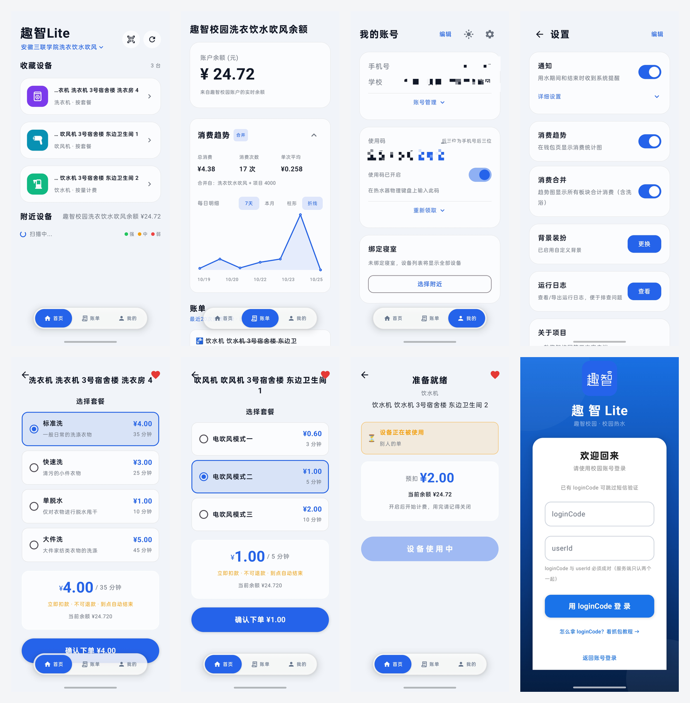

| 首页 | 余额与消费趋势 | 我的账号 | 设置 |
|---|---|---|---|
| 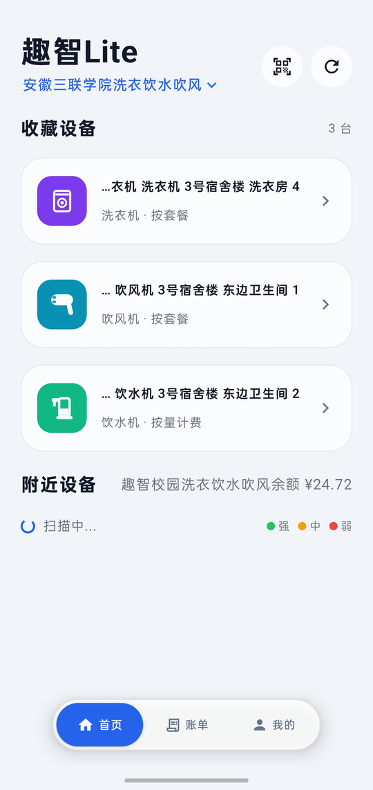 | 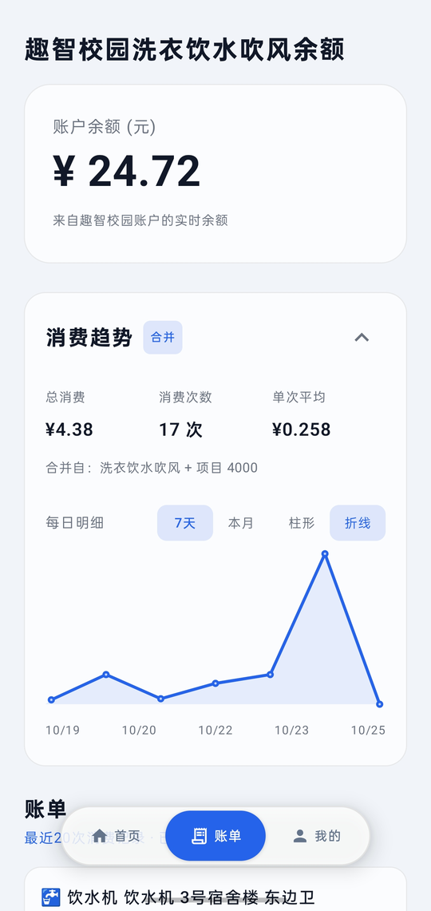 | 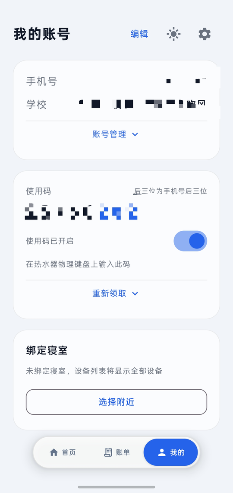 | 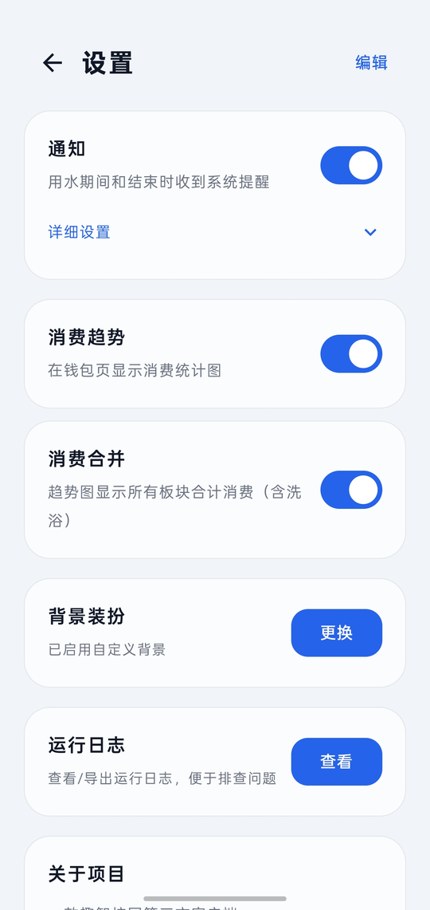 |

### 两种计费，两个界面

设备点开直接进对应操作页——分流的依据是**计费模型**，不是设备类型。

| 洗衣机 · 选套餐（扣全款、不可退） | 吹风机 · 选套餐 | 饮水机 · 准备就绪（按量、可中途关） |
|---|---|---|
| 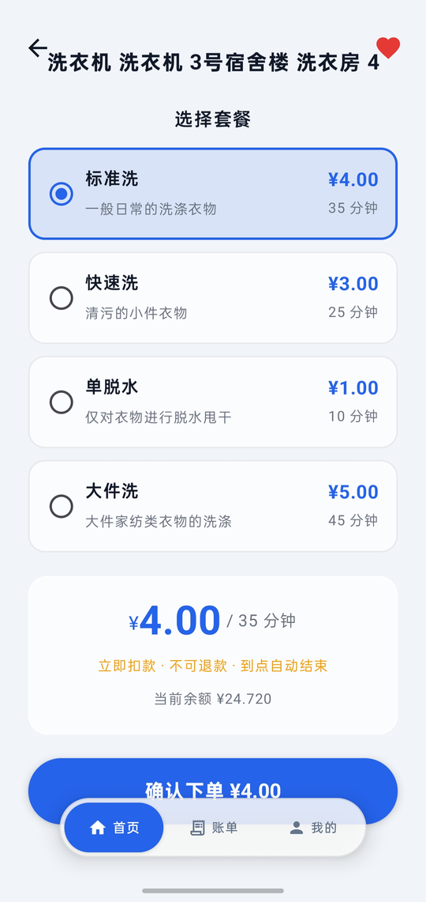 | 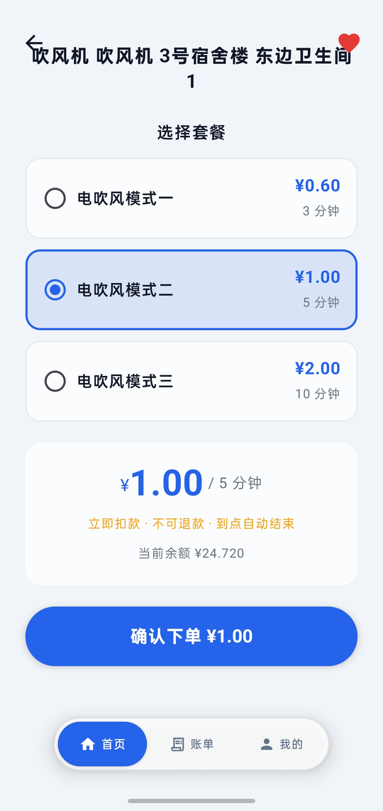 | 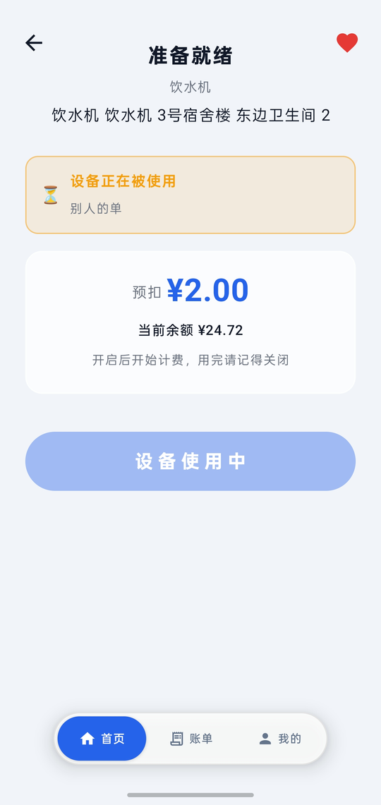 |

### 三种登录方式

默认短信验证码登录；也可用密码；已抓过包的话还能直接用 **loginCode + userId** 跳过验证码。

| loginCode + userId 登录 |
|---|
| 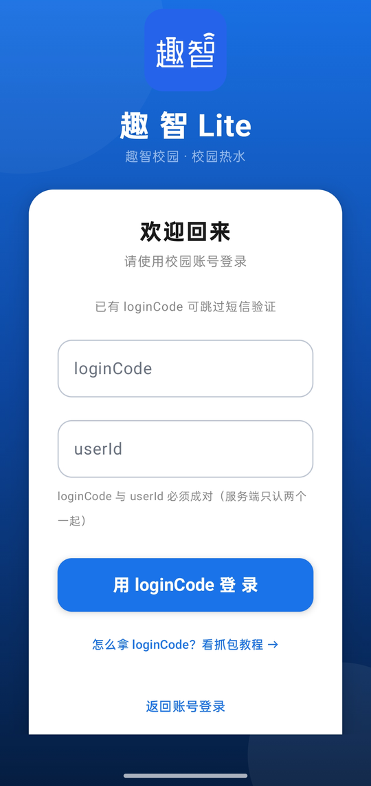 |

> loginCode 与 userId **必须成对**（服务端只认两个一起，少一个就回 `errorCode=8`）。
> 这两个值怎么抓见 [WIKI-抓包获取loginCode.md](docs/WIKI-抓包获取loginCode.md)。

### 背景装扮

把喜欢的图片设成界面背景，App 会自动从图里提取主题色作为强调色；主页与使用页各存一套，互不影响。

| 背景设置 | 主页 | 使用页 |
|---|---|---|
| 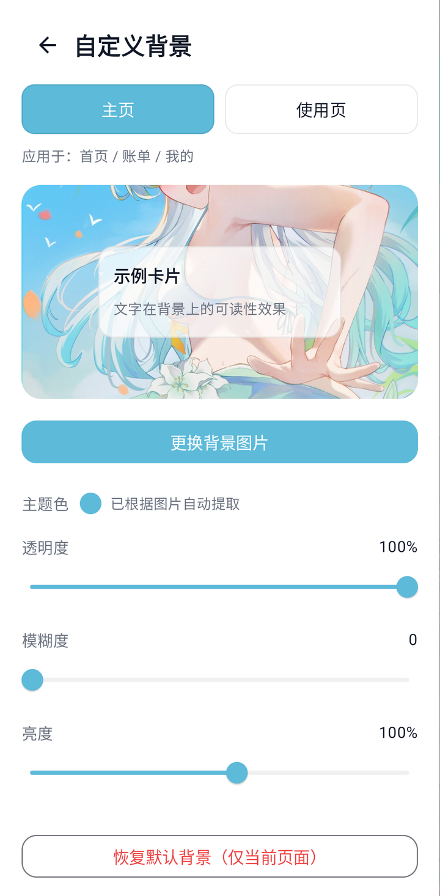 | 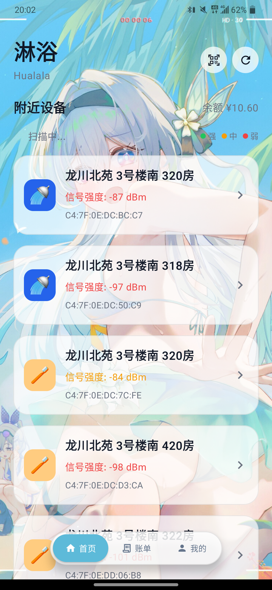 | 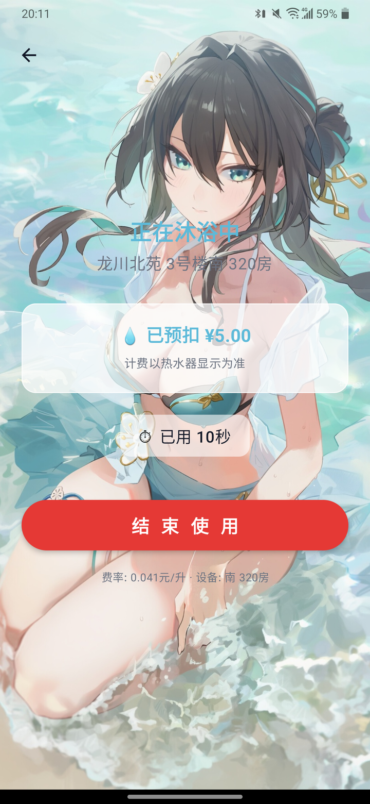 |

> 使用页套用自定义背景后不再显示设备图标——背景图本身就是画面主体。

### 桌面小组件

在桌面直接启停热水，不用打开 App。

| 2x2 · 空闲 | 2x2 · 使用中 | 2x4 · 设备控制 |
|---|---|---|
| 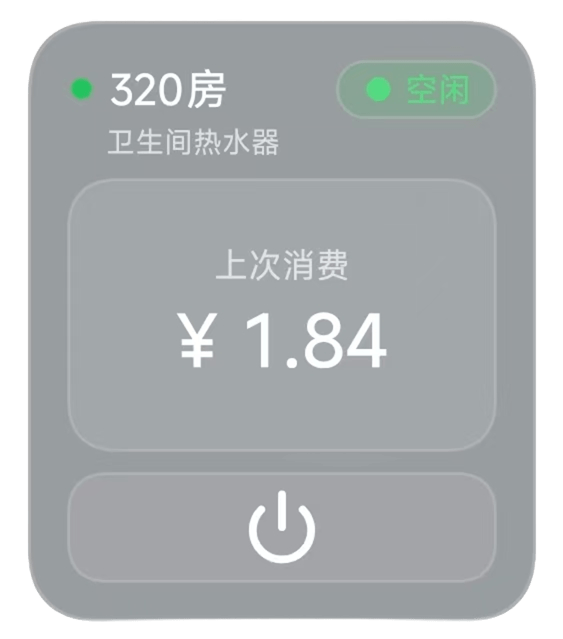 | 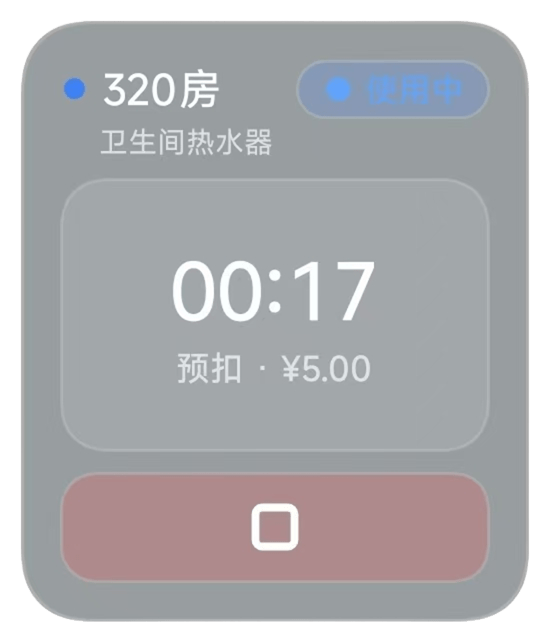 | 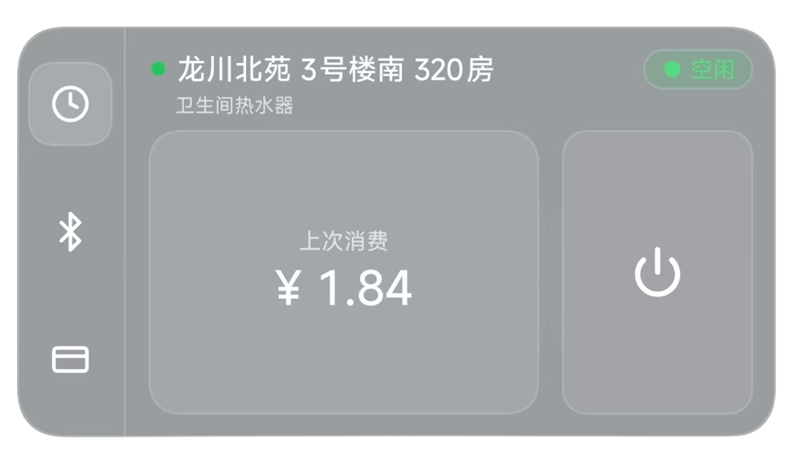 |

| 2x4 · 附近设备 | 2x4 · 账单 |
|---|---|
| 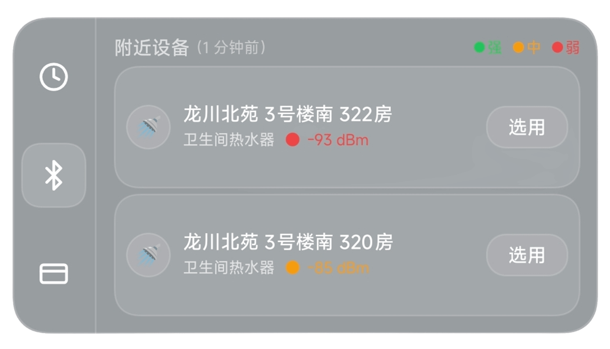 | 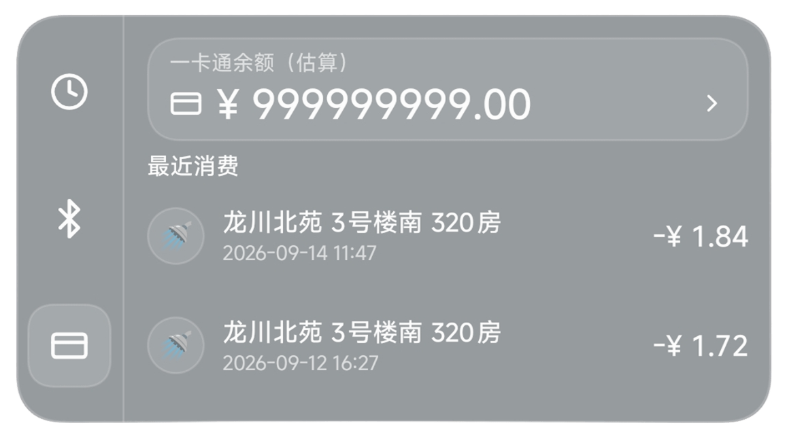 |

## ✨ 功能

### 🚿 设备控制

- 🔐 **三种登录方式** — 默认**短信验证码登录**（未注册的手机号会自动创建账号）、密码登录、以及**loginCode + userId** 登录（已抓过包就免验证码）；支持系统自动填充，登录状态加密持久化与自动恢复
- 🧭 **多板块（项目）切换** — 一个手机号可能绑多个独立项目（例：① 洗浴 ② 洗衣饮水吹风），各有独立账户、钱包、账单。首页标题栏可直接切板块，切完设备/余额/账单全部跟着换
- 📡 **蓝牙扫描** — BLE 扫描附近设备，按信号强度排序；权限按需申请，Android 12+ 不需要定位权限
- 📷 **扫码绑定** — 扫描设备二维码直接弹出设备详情，无需蓝牙；也可以**从相册选图识别**，光线不足时有**手电筒**
- ⭐ **收藏设备** — 附近设备长按、或使用页右上角心形即可收藏（上限 30 条，字段全落盘，**离线也能用**）；和「上次使用」是两张独立的卡片
- 🏠 **绑定寝室** — 在「选择附近」里选一间寝室，首页**和桌面小组件**的设备列表都只显示该寝室的设备
- 🚿 **一键洗澡** — 选择设备即可开始，支持停止和恢复；开阀前二次确认，失败有提示
- ⏳ **自动关停倒计时** — 显示闲置自动关闭倒计时，关闭时弹出确认框
- 🔔 **后台用水监控** — 监控跑在前台服务里，**退出 App、划掉最近任务都不影响**：超时自动关停照常生效
- 🔕 **系统通知** — 用水期间通知栏常驻状态条并带「结束用水」按钮；结束、超时自动关停、**开阀失败**都有提醒
  - 开阀失败 / 设备被占用 / 超时关停会弹**横幅**，「横幅提醒」可单独关掉
  - 支持 ColorOS 流体云胶囊倒计时（**需在系统设置里手动给本 App 开「实时动态 / 流体云」权限**）
- 💰 **消费结算** — 关阀后直接向服务端查这一单结算了多少钱，结束通知里给出**本次消费金额和用水时长**
- 🔌 **蓝牙水表直连** — 部分学校的表不联网，手机**通过蓝牙直连**即可开阀 / 关阀 / 结算：关阀即结清、遗留订单自动补结算、App 被杀重开能恢复用水；通知栏「结束使用」和桌面小组件都能走蓝牙关阀，App 被杀也能关
- 🧩 **桌面小组件** — 1x1 / 2x2 / 2x4 三种尺寸，桌面直接启停热水；深色液态玻璃卡片，布局随尺寸自适应
  - **1x1 是一个按钮**：一格大小，点一下开/关；顶部小字标「空闲 / 使用中 / 占用中」，操作中显示转圈
  - 2x4 带侧边导航，可切换「设备控制 / 附近设备 / 账单」三页
  - 操作状态在桌面上**全局同步**：点任一个组件，所有热水器组件同时显示「正在开启…」并转圈
  - 点「上次消费」卡片进 App 账单页；使用中点计时卡片直接关阀
  - 附近设备「选用」直接在桌面切换控制设备，不用打开 App

### 🧺 按套餐计费的设备（洗衣机 / 吹风机）

- 🧾 **选套餐下单** — 洗衣机（标准洗 / 快速洗 / 单脱水 / 大件洗）、吹风机（模式一/二/三）按服务端下发的套餐列表渲染，**默认选中服务端标记的那档**
- 💸 **下单前必须看清三件事** — 「X 元 / N 分钟」「立即扣款 · 不可退款 · 到点自动结束」「当前余额」；余额不足或查不到时额外拦一次
- ⏱ **剩余倒计时** — 下单后显示倒计时通知与使用页；**到点由服务端自动关停**，客户端不做也不会做「停止」
- 🚫 **防抢占** — 停在选套餐页犹豫时每秒核对设备状态，被别人抢先就顶部横幅提示并禁用按钮（只降级不打断，不自动跳页）

### 💰 钱包与账单

- 💳 **一卡通真实余额** — 直接读取校园卡账户余额，不再是估算；未签约免密支付时自动回退并注明
- 🧾 **残留账单补扣** — 12 点后结束用水或余额不足导致没扣成的账单，可以在账单上手动「请求代扣」
- 📋 **账单查询** — 查看当月消费记录和详情，按设备类型着色
- 📈 **消费趋势** — 近 7 天 / 本月、柱形 / 折线切换、峰值标注，卡片可折叠；选择会被记住
- 🔗 **消费合并** — 一个开关把各板块的消费合到一张图里，标题会标注「合并自：X + Y」

### 👤 账号

- 🪪 **个人信息卡片** — 姓名、学号、学校自动获取，不用手填
- 📱 **更换手机号** — 验证码发到新号码，改完即时生效
- 🔑 **修改密码** — 支持密码方式和**短信验证码方式**（没设过密码、或忘了密码都能用）
- 🎫 **使用码** — 领取 / 重新领取前可先预览，「换一个」每天 20 次，确定领取才真正替换；取消不会影响正在用的码
- 💾 **备份 / 恢复** — 换手机、重装、或者只是想留个底的时候用
  - **可以分开备，也可以一起备**：只备收藏（纯本地数据，默认不加密，想加也行）、只备登录凭证，或者两样都备
  - **含登录凭证的备份强制加密**（AES-256-GCM，密码用 PBKDF2 加盐派生）——这条是数据层强制的，不是界面上的提醒，改界面也写不出明文凭证
  - **不需要任何存储权限**：用系统的文件选择器自己挑位置，App 只拿到你选的那一个文件的读写权
  - **登录页也能恢复**：还站在登录页（换机 / 重装后）时点「从备份包恢复登录 →」，选文件输密码就行
  - 恢复凭证前会**先拿它去问服务端还能不能用**，能用才写进本地——不会让你「恢复成功」之后一秒被踢回登录页
  - 恢复收藏是**按设备合并**，不会覆盖掉你手机上已有的收藏
  - ⚠️ 密码忘了就真的打不开（没有后门），备份时请顺手记在密码管理器里

### 🎨 个性化

- 🖼 **背景装扮** — 主页与使用页各一套独立背景，自动提取主题色，支持透明度 / 模糊 / 亮度调节
- 🌓 **深浅主题** — 圆形揭示切换动画，设置自动保存
- 🧩 **卡片自定义** — 「我的」页面卡片可上下排序、隐藏显示
- 📶 **断网提示** — 网络异常时友好提示
- 👥 **挤号检测** — 多设备登录自动提醒，25 秒心跳轮询，被挤下线能及时弹出提示

### 🔧 其他

- 📜 **内置运行日志** — 内存 + 文件双缓冲，敏感信息自动打码，崩溃自动捕获，可一键分享导出
- 🔄 **应用内更新** — 自动读取 GitHub Release 比对版本、展开查看更新日志，并可直接在应用内下载安装
  - **双通道**：dev 测试包只看**测试版**（pre-release），正式包只看**正式版**——测试版不会把普通用户拉下水，正式版也不会被一个测试版提示「有新版本」
  - 更新日志默认只列最近 3 个版本，点「展开全部」看其余
  - ⚠️ 仓库暂无 Gitee 镜像（`GITEE_REPO = ""`），下载走 GitHub 直链，大陆可能较慢
- 🔐 **加密存储** — 登录凭证加密存储（EncryptedSharedPreferences）

## 📖 文档

全部文档都在 [`docs/`](docs/) 目录：

| 文档 | 说明 |
|---|---|
| [PROJECT.md](docs/PROJECT.md) | 完整项目文档：技术架构、项目结构、构建方法、功能清单 |
| [CHANGELOG.md](docs/CHANGELOG.md) | 版本更新日志 |
| [SECURITY.md](docs/SECURITY.md) | 安全说明：如何验证正版、我们的安全设计、已知暴露面 |
| [API-qzxy.md](docs/API-qzxy.md) | 趣智校园 API 逆向工程完整参考（**含全部 35 个接口**，多板块 / 套餐 / 蓝牙水表 / 代扣都在） |
| [开发者指南.md](docs/开发者指南.md) | 面向第三方开发者的开发指南 |
| [交接文档.md](docs/交接文档.md) | 给接手者：业务模型、代码地图、验证状态、**绝对不要做的事** |
| [开发日志.md](docs/开发日志.md) | 每轮改动的原因、验证方式与遗留问题 |
| [图标资产说明.md](docs/图标资产说明.md) | 设备图标 ↔ 数据层 emoji 对应关系、7 条硬约束、造型禁区 |
| [WIKI-抓包获取loginCode.md](docs/WIKI-抓包获取loginCode.md) | 怎么抓 loginCode（登录页直接链到这份） |

## 🔧 适配你的学校

趣智校园在各地的部署不一样，按需要的改动量可以分三类。**先直接下载发行版试，能用就不用管下面的内容。**

### ✅ 多数学校：直接装就能用

**projectId 不需要手动填，也不需要抓包。** 它由服务器在登录时下发，客户端自动获取并沿用到后续所有请求——项目里没有硬编码任何学校的 projectId。

短信验证码登录的 `secret` 同理，是按手机号在本地算出来的（见 `utils/SignUtils.kt`），任何学校、任何手机号都能用：

```
secret = MD5( 手机号前3位 + 手机号后4位 + "klcx" )
```

### ⚠️ 部分学校：可用设备类型不同

各校接入的设备不一样，已适配的有这些，App 会自动识别并区分显示：

| 设备 | 识别方式 | 计费 | 界面表现 |
|---|---|---|---|
| 热水器 | **兜底**（其余情况都是它）；附近扫描时靠蓝牙广播名 `KLCXKJ-Water` | 按量 | 🚿 蓝色，正在沐浴中 |
| 洗手台 | 设备名以「洗手台」开头 | 按量 | 🪥 橙色，正在洗漱中 |
| 洗衣机 | `bigTypeId == 6`（`smallTypeId` 3） | **套餐** | 🧺 紫色，选套餐下单 |
| 吹风机 | `bigTypeId == 7`（`smallTypeId` 5） | **套餐** | 💨 青色，选套餐下单 |
| 直饮水机 | `bigTypeId == 5`，或名字里带「饮水 / 直饮 / 开水机 / 冷水」等**饮水机独有**的词 | 按量 | 🚰 绿色，正在接凉水 / 热水 |

> **计费模型决定界面，不是设备类型**：判据收口在 `data/ModeOrderPolicy.billingModel`。
> 饮水机虽然和洗衣/吹风在同一项目里，但按量计费，走的是洗澡那套页面。

如果设备名格式特殊，设备名简化和类型识别可能不准，可以在 `model/DeviceModels.kt` 里补规则。

### 🔧 少数学校：需要自行改代码重新编译

只有部署方式与常见情况不同时才需要动，一共两处：

| 位置 | 当前值 | 不改会怎样 |
|---|---|---|
| BLE 设备名过滤 | `KLCXKJ-Water` | 扫不到附近设备（扫码绑定不受影响，仍可用） |
| MQTT 服务器 | `tcp://47.107.37.60:1883` | 收不到实时推送（不影响开关阀与下单，HTTP 轮询仍正常） |

> ⚠️ MQTT 地址**不是通用的**：吹风机抓包实测的是 `39.108.147.136:1883`。
> 服务端不匹配时的后果只是「orderNo 慢几秒」（退到 `/order/query/lastOrder/byMac` 兜底），功能不挂。

改完自行编译即可，构建方法见 [PROJECT.md](docs/PROJECT.md#构建说明)。

## 🛠 自己编译

```powershell
# 需要 Android SDK（platform 36 / build-tools 36）与 JDK 21
$env:JAVA_HOME    = "C:\Program Files\Android\Android Studio\jbr"   # 换成你的 JDK 21
$env:ANDROID_HOME = "C:\Android"; $env:ANDROID_SDK_ROOT = "C:\Android"
cd linyu

# 两个 flavor：
#   store —— 原版，包名 com.quzhi.lite，不含任何预置凭证
#   dev   —— 包名 com.quzhi.lite.dev，可与官方 App 共存，可从 local.properties 预置登录态
.\gradlew.bat :app:assembleStoreDebug
.\gradlew.bat :app:assembleDevDebug

# Release（R8 混淆 + 资源压缩；配好签名后会自动签名）
.\gradlew.bat :app:assembleStoreRelease
.\gradlew.bat :app:assembleDevRelease

# ⚠️ 测试任务名带 flavor，testDebugUnitTest 会失败
.\gradlew.bat :app:testDevDebugUnitTest :app:testStoreDebugUnitTest
```

打包前请把 `linyu/local.properties` 里的 `sdk.dir` 配好；该文件含签名路径与预置凭证，已在 `.gitignore` 中，**不会入库**。

### 🔑 自己出签名 Release

要打**可安装的** release 包，还得在同一个 `local.properties` 里补四行（生成 keystore 用 `keytool`）：

```properties
KEYSTORE_FILE=../your-key.jks
KEYSTORE_PASSWORD=你的密钥库密码
KEY_ALIAS=你的别名
KEY_PASSWORD=你的密钥密码
```

> ⚠️ **这四项缺任意一项（或 keystore 文件路径不存在）时，Gradle 只打一条 warn，
> 然后静默产出未签名的 release 包**——构建显示成功，但那个 APK 装不上。
> 所以出包后请务必验一次签名，别等用户报「解析包时出现问题」：
>
> ```powershell
> & "$env:ANDROID_HOME\build-tools\36.0.0\apksigner.bat" verify --print-certs app\build\outputs\apk\store\release\app-store-release.apk
> ```
>
> 输出里应当有 `certificate SHA-256 digest`；官方的正式版是 `81:7F:13:F0:...`（你自己签的当然不一样，那是对的）。

---

## 📦 发布规范（维护者必读）

两个包走**两条互不相交的更新通道**，Release 说明又会被 App 解析成更新日志，
所以发版有一套必须遵守的规则。不按这套来会出现两种故障，都已在真机上发生过：

| 不守规范的后果 | 现象 |
|---|---|
| tag 数字没有变大 | 已安装用户点「检查更新」永远显示「当前已是最新」，**收不到这次更新** |
| Release 说明的标题没写对 | 更新日志在 App 里显示「本版本未填写更新详情」，**用户以为你没写** |

### 两种包的区别

| | 正式版 | 测试版 |
|---|---|---|
| flavor / 构建命令 | `store` / `assembleStoreRelease` | `dev` / `assembleDevDebug` |
| 包名 | `com.quzhi.lite` | `com.quzhi.lite.dev` |
| 版本名 | `3.x.y` | `3.x.y-dev` |
| 签名 | **release 密钥** | debug 密钥 |
| 更新通道 | 只看**正式版**（非 pre-release） | 只看**测试版**（pre-release） |
| Release 是否勾 pre-release | ❌ 不勾 | ✅ 勾 |

> 两者的包名和签名都不同，**无法互相覆盖安装**，但可以同时装在一台手机上。

### 发版前检查清单

**① 版本号必须真的变大**

```kotlin
// app/build.gradle.kts
versionCode = 19        // 必须比上一版大，不能重复
versionName = "3.2.2"   // dev 包会自动变成 3.2.2-dev
```

⚠️ App 的更新判断是 `ApkUpdater.isNewer()`，它把 tag **逐段比数字**。

- ✅ `v3.2.2` 比 `v3.2.1` 大 → 老用户能看到更新
- ❌ `v3.2.1-hotfix`、`v3.2.1-dev.2` 这类「数字没变大」的命名 → `[3,2,1]` 对比 `[3,2,1]` 相等，**判定为已是最新，用户收不到更新**
- 想靠后缀递增触发更新是行不通的，只能升数字段

**② Release 说明必须让标题含关键词**

App 解析更新日志时，**优先**只摘录标题里含「**新增** / **功能** / **修复** / **BUG**」的段落（让日志短而聚焦）。

- 有命中 → 只显示这些段落（推荐，界面干净）
- 一个都没命中 → **回退显示全文**（所以不会空白，但会把「安装说明」「已知问题」也显示出来，还得截断）

所以规范写法是：

```markdown
## 趣智Lite v3.2.2（正式版）     ← 一级标题，随便写

### 本次新增与修复                ← ✅ 含「新增」，会被摘录
...正文...

### 安装说明                     ← 不会进摘录（好，本来就只给下载页看）
### 已知问题                     ← 不会进摘录
```

**③ 两个 Release 的设置不能搞反**

```powershell
# 正式版：不勾 --prerelease（GitHub 会自动标为 Latest）
gh release create v3.2.2  "quzhi-lite-v3.2.2.apk" --notes-file notes.md

# 测试版：必须勾 --prerelease
gh release create v3.2.2-dev "quzhi-lite-dev-v3.2.2.apk" --notes-file notes-dev.md --prerelease
```

搞反的后果：正式版被标成 pre-release → 正式包看不到它，永远显示「暂无正式版本」；
测试版没标 → **所有正式版用户都会被提示升级到测试包**。

**④ 出包后必须验签名**

```powershell
& "$env:ANDROID_HOME\build-tools\36.0.0\apksigner.bat" verify --print-certs `
    app\build\outputs\apk\store\release\app-store-release.apk
```

指纹必须是 `81:7F:13:F0:56:B0:08:1F:C2:36:83:74:31:5F:BD:7C:CD:8E:0C:8B:AC:7C:2C:04:06:7E:21:EC:A5:AE:BA:E7`。
缺签名配置时 Gradle **只 warn 不报错**，会静默产出装不上的未签名包。

**⑤ 正式包不含预置凭证**

`local.properties` 里的 `QZXY_PREFILL_*` 只在 dev flavor 生效，store flavor 显式置空。
出包后可用 `tools/verify_apk.py` 复核：

```powershell
cd linyu; python tools\verify_apk.py
```

应当看到 store 包「✅ 干净（无凭证）」。

### 常见错误对照

| 错误 | 结果 | 正确的做法 |
|---|---|---|
| 只改了 tag、没改 `versionCode` | 用户收不到更新 | 两个都改 |
| tag 用 `v3.2.1-fix` 这种 | `[3,2,1]` 不比 `[3,2,1]` 大，判为最新 | 用 `v3.2.2` |
| 说明里只有「本次更新内容」标题 | 走回退全文，旧版本日志显乱 | 标题写「本次新增与修复」 |
| 测试版忘了 `--prerelease` | 正式用户被推向测试包 | 加 `--prerelease` |
| 正式版勾了 `--prerelease` | 正式包看不到它 | 别勾 |
| 没验签名就发布 | 用户「解析包时出现问题」 | 每次验 |

---

## ⚠️ 已知问题与限制

下面这些多数受服务器或系统限制，当前无法解决。已修复的历史问题见 [CHANGELOG](docs/CHANGELOG.md)。

| 问题 | 说明 |
|---|---|
| **套餐没有「停止」** | 服务端**不提供**任何停止 / 取消 / 退款接口，点了到点自动结束。不要期待能做出来 |
| **挤号检测有延迟** | 靠心跳轮询实现，被挤下线最多 25 秒后才提示 |
| **无实时扣费** | MQTT 仅在订单结束时推送消费金额，洗澡中看不到实时扣费。官方 App 也是如此 |
| **一卡通余额需已签约** | 未签约免密支付的学生拿不到真实余额，会自动回退到本地估算并在界面上注明 |
| **MQTT 地址不通用** | 代码里硬编码了一个 broker，吹风机实测是另一个；不匹配时 orderNo 靠 `lastOrder/byMac` 兜底（有约 1 小时窗口） |

### 🏫 兼容性

| 问题 | 说明 |
|---|---|
| **仅支持 64 位设备** | v2.2.2 起安装包只包含 arm64-v8a，纯 32 位的老机型装不上 |
| **各校部署有差异** | 已在多所学校被实际使用，但各校网络请求接口信息可能不同 |
| **饮水机功能未实机验证** | 饮水机识别与 UI 已实现，但作者所在学校无直饮水机，实际控制流程未验证 |
| **洗衣机真实下单未验证** | 套餐下单全链路只实测过**吹风机**，洗衣机（`bigTypeId=6`）只到编译与单测 |
| **备份密码忘了没有救** | 加密备份包只能靠那个密码打开，App 里**没有后门也没有找回入口**。忘了就真的打不开——备份时请存进密码管理器 |
| **Android 12 以下仍需定位权限** | 系统对蓝牙发现的硬性规定，无法绕过；引导卡片里说明了原因 |
| **自动填充依赖手机密码管理器** | 不同厂商 ROM 行为差异较大，未在多数机型上验证 |
| **流体云胶囊要手动授权** | ColorOS 的实时状态需用户在「设置 → 通知 → 流体云」里给本 App 打开，代码无法代劳 |

### 🔒 安全

| 问题 | 说明 |
|---|---|
| **MQTT 明文** | 趣智校园 MQTT 服务器不支持 TLS，通信内容未加密 |
| **密码 MD5** | 趣智校园使用 MD5 取后 10 位，安全性低（官方协议限制） |
| **签名≠正版** | v3.2.1 起正式版已是 **release 签名**（证书 SHA-256 `81:7F:13:F0:56:B0:08:1F:...`，可自行核对）。但**签名只能证明同源**：别人可以用自己的密钥造一个同样"签名自洽"的包，所以**下载渠道才是身份凭据**。详见 [SECURITY.md](docs/SECURITY.md) |
| **dev 测试包仍是 debug 签名** | `com.quzhi.lite.dev` 是测试分包，可与官方 App 共存；不能上架，也不该拿来当正式版用 |

完整披露见 [SECURITY.md](docs/SECURITY.md)。

### 🎨 体验

| 问题 | 说明 |
|---|---|
| **深色模式不全** | 登录页是硬编码浅色（不跟随系统/App 主题）；洗澡页与按量操作页按 App 内的主题设置切换，不跟随系统；扫码页固定深色 |
| **仅中文界面** | 无多语言支持 |
| **小图标细节丢失** | 14dp 档位下吹风机的格栅会糊成两个白点，20dp 起清晰（24dp 图标缩到 14dp 的固有代价） |
| **登录页没有「忘记密码」** | `/user/password/forget` 接口已实现，但入口只在进 App 后的设置里 |

> 欢迎提 Issue 或 PR 帮助改进！

## 🙏 感谢

### 特别鸣谢：本项目的基础框架来自 [@yehu-imei](https://github.com/yehu-imei)

「趣智Lite」不是从零写的。**整个项目的底子——原始代码框架、热水器开阀 / 关阀与结算链路、
短信登录的 secret 逆向、MQTT 协议、一卡通余额代理接口的发现——都来自
[yehu-imei](https://github.com/yehu-imei) 的原始项目**。

没有那份基础框架，这个项目不可能存在。本仓库是在它之上继续做多板块、套餐计费、
蓝牙水表、界面与图标改造的，原作者的开创性工作值得单独记在这里。

| 贡献者 | 贡献内容 |
|---|---|
| **[@yehu-imei](https://github.com/yehu-imei)** | **★ 基础框架与全部原始实现**：热水表开阀 / 关阀 / 结算链路、MQTT、短信 secret 算法、一卡通余额接口 |
| [@Cainite07](https://github.com/Cainite07) | 短信登录的实现 |
| [@SubmergeDQ](https://github.com/SubmergeDQ) | 蓝牙阀控制的实现 |
| [@f3ngka0](https://github.com/f3ngka0) | 蓝牙水表 28 字节状态帧支持（[PR #11](https://github.com/shierpuzi/linyu/pull/11)） |
| [@Asyreale](https://github.com/Asyreale) | 蓝牙表广播地址与小组件状态修复（[PR #8](https://github.com/shierpuzi/linyu/pull/8)、[#9](https://github.com/shierpuzi/linyu/pull/9)） |
| [@XiaoLoad](https://github.com/XiaoLoad) | 项目优化的宝贵建议 |
| 各位同学们 | 软件的测试与体验反馈 |

> 每一段代码、每一条建议、每一次测试，都在让「趣智Lite」变得更好。谢谢你们 🙌

## 📄 许可证

[MIT License](LICENSE)

## ⚖️ 免责声明

本项目仅供学习和研究用途。使用者应自行遵守趣智校园及相关服务的使用条款。开发者不对因使用本项目产生的任何后果承担责任。
