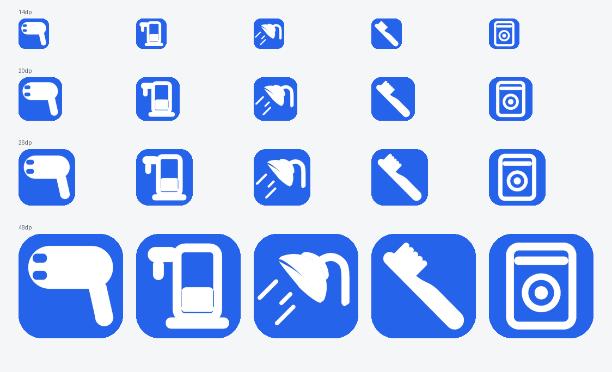
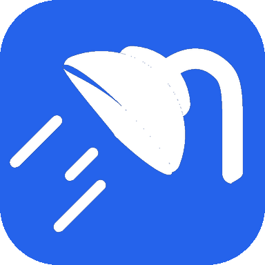
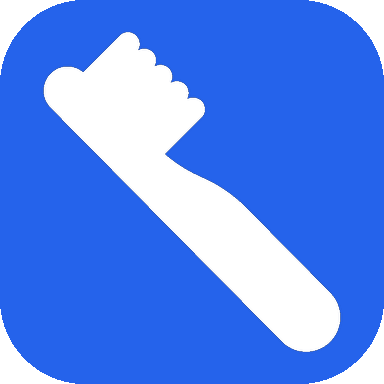
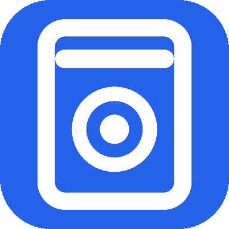
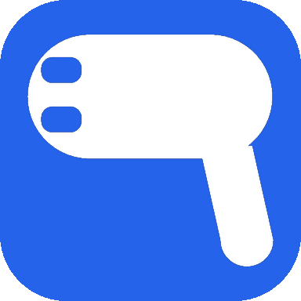
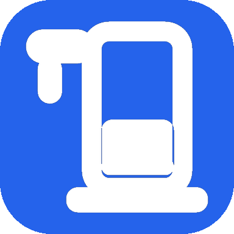

# 图标资产说明

> 本文件管的是**图标资产的对应关系与替换规则**。
> 要替换任何图标，只需按「对应关系表」找到文件路径，保持同样的硬约束替换即可——
> 代码侧不需要改动（映射关系集中在**一处**：`utils/DeviceVisual.kt`，见 §4）。



> 上图由 `python tools/preview_vector.py --all --sheet` 生成，蓝底是设备类型色（统一取主题蓝）。

---

## 1. 为什么要有这份文档

图标在项目里有两个容易踩空的点：

1. **数据层用 emoji 字符串做设备类型标识**（`PrefsHelper.lastDeviceEmoji`、小组件 JSON 快照）。
   这是刻意的设计：老用户存的值不能失效。所以**渲染层和映射表的 emoji 是「键」，不是装饰**，
   换图标时不能顺手把这些 key 改掉。
2. **同一份映射曾经写过三处**（Compose 一处、桌面小组件 RemoteViews 一处、
   通知则是完全没接、一律水滴），因为小组件不能用 Compose。改一边忘了另一边，
   就会出现「App 里是洗衣机图标、桌面上是热水器图标」。

所以：**换图只换 drawable 文件；改映射只改 `utils/DeviceVisual.kt` 一处。**

> 历史（2026-10-29 #36）：第三条链路（通知）接进来时，把三份 `when` 收口成了
> `utils/DeviceVisual.kt` 一个 object，其余各处只转发。以前这里写的是「改映射要
> 同时改两处」——那个说法已经过期，现在**只有一处**，且 `DeviceVisualTest` 会盯着。

---

## 2. 硬约束（所有图标必须满足）

改任何图标前先确认这 7 条，违反其中一条在多机型/小尺寸下就会出问题：

| # | 约束 | 为什么 |
|---|---|---|
| 1 | `24dp` 画布，`viewportWidth/Height = 24` | 全项目统一，缩放比例才一致 |
| 2 | **单色实心**填充 `#FF000000`，颜色由使用处 tint | 图标要压在蓝/橙/绿/紫等不同圆底上 |
| 3 | **禁止 stroke**、禁止 alpha、禁止渐变 | 小组件通知栏会整体染色，带 alpha 会糊成一坨白块 |
| 4 | **圆和圆角一律用 `A`（圆弧）命令** | 用 `C`/`S` 贝塞尔凑圆，20dp 下会显出菱形棱角（实测踩过） |
| 5 | 细节/线宽 **≥ 1.2 个 viewport 单位** | 在 14dp 下小于 1.2u 的细节必然消失 |
| 6 | 需要挖洞用 `android:fillType="evenOdd"` + 同心子路径 | 环形、内凹槽都靠它 |
| 7 | **不要用 `<group>` 变换**（除非必要） | 预览脚本能处理，但手改数字时极易算错；能原生坐标画就原生画 |

### 关于尺寸档位的现实

图标按 **26dp**（列表头像）、**64/72dp**（全屏页）实际渲染，少数场景 14dp。

- **20dp 以上**：所有图标清晰可辨
- **14dp**：只剩轮廓可认，这是 24dp 缩到 14dp 的固有代价，**不是图标没做好**

所以评估图标时请以 20/26dp 为准，14dp 只要求「不糊成一团」。

---

## 3. 对应关系表

### 3.1 设备类型图标（`ic_device_*`）

这 5 个是**设备头像**，在「附近设备」「上次使用」「收藏」「使用中」卡片、
以及桌面小组件里显示。它们由一个 emoji 字符串驱动，见下表「数据层 key」列。

| 图标文件 | 对应设备 | 数据层 key（emoji） | 类型底色 | 造型要求 |
|---|---|---|---|---|
| [`ic_device_shower.xml`](../app/src/main/res/drawable/ic_device_shower.xml) | 热水器 / 花洒 | `🚿`（也是兜底） | `#2563EB` 蓝 | 花洒喷头 + 水管 + 水线；用 `<group>` 缩放 |
| [`ic_device_sink.xml`](../app/src/main/res/drawable/ic_device_sink.xml) | 洗手台 | `🪥` | `#FFCC80` 橙 | 牙刷；用 `<group>` 缩放 |
| [`ic_device_washer.xml`](../app/src/main/res/drawable/ic_device_washer.xml) | 洗衣机 | `🧺` | `#7C3AED` 紫 | 圆角机身 + 顶部控制条 + 舱门圆环 + 内桶实心圆 |
| [`ic_device_dryer.xml`](../app/src/main/res/drawable/ic_device_dryer.xml) | 吹风机 | `💨` | `#0891B2` 青 | 横向等宽风筒 + 后置手柄 + 前端内嵌格栅槽 |
| [`ic_device_faucet.xml`](../app/src/main/res/drawable/ic_device_faucet.xml) | 饮水机 | `♨️` / `❄️` / `🚰` | `#10B981` 绿 | 竖长机身 + 顶部外伸出水头 + 机身内凹接水槽 + 宽底座 |

单图（384×384，蓝底白图，= 26dp 左右的实际观感）：

| 热水器 | 洗手台 | 洗衣机 |
|---|---|---|
|  |  |  |

| 吹风机 | 饮水机 |
|---|---|
|  |  |

**饮水机为什么三个 key 共用一个图**：26dp 单色图标塞不下冷热差异；
冷热由界面文案（「正在接热水/凉水」）和类型说明（「直饮水机 · 热水」）表达。

**饮水机造型说明**：试过「纯水龙头」方案，但和其余 4 个「整机轮廓」的图标并列时
视觉重量偏轻、语义偏「接水」而非「饮水机」。最终用竖长机身版——它和洗衣机
（方机身+圆窗）属于同一套「整机」语言。曾被否决的两个坑见 §3.2。

### 3.2 设备图标的造型禁区（实测踩过的坑，别再走回去）

| 图标 | 不要这么做 | 会被读成 |
|---|---|---|
| 洗衣机 | 控制条做成「旋钮 + 条」 | 24 viewport 内塞旋钮会低于 1.2u，小尺寸必糊 |
| 吹风机 | 出风口画成风筒**外侧**的浮动短横 | **电源插头**（14dp 实测） |
| 吹风机 | 手柄放风筒**中段** | **锤子**（20dp 实测，试了 6 版全是锤子） |
| 饮水机 | 出水嘴同侧做**凸出**托盘 | **马克杯把手**（负空间闭合成圈） |
| 饮水机 | 居中凹槽 + 居中单龙头 | **售货机屏幕 / 一张脸** |
| 饮水机 | 顶部画水桶 | **小人 / 棋子** |
| 饮水机 | 水嘴与杯壁连成一体 | 字母 **T / U** 或数字 **1** |
| 饮水机 | 改成实心大方块 | fill 会到 0.73，与其它图标并排**发胖** |

**墨量参考**（fill = 墨迹面积 / 画布面积，用来避免并排时轻重失衡）：

| 图标 | area | fill |
|---|---|---|
| 洗衣机 | 182.3 | 0.56 |
| 吹风机 | 196.1 | 0.54 |
| 饮水机 | 194.4 | 0.53 |

新图标建议落在 **0.50 ~ 0.58** 区间。

### 3.3 界面通用图标（`ic_*`）

这些是界面元素，不对应设备类型，**不参与 emoji 映射**。

| 图标文件 | 用途 | 使用位置 | 造型要求 |
|---|---|---|---|
| [`ic_drop.xml`](../app/src/main/res/drawable/ic_drop.xml) | 水滴 | 预扣金额提示（`ShowerScreen` / `MeteredDeviceScreen`） | 上尖下圆的水滴 |
| [`ic_warning.xml`](../app/src/main/res/drawable/ic_warning.xml) | 警告 | 「凭证未加密存储」提示（`UserScreen`） | 三角外框 + 感叹号，`evenOdd` 挖空 |
| [`ic_close.xml`](../app/src/main/res/drawable/ic_close.xml) | 关闭 | 登录页输入框清空按钮 | 叉号 |
| [`ic_room.xml`](../app/src/main/res/drawable/ic_room.xml) | 寝室 | 绑定寝室卡片 | 房屋轮廓 |
| [`ic_star.xml`](../app/src/main/res/drawable/ic_star.xml) | 星标 | 收藏 / 评分位 | 五角星 |
| [`ic_theme_dark.xml`](../app/src/main/res/drawable/ic_theme_dark.xml) | 深色模式 | 设置页主题切换 | 月亮 |
| [`ic_theme_light.xml`](../app/src/main/res/drawable/ic_theme_light.xml) | 浅色模式 | 设置页主题切换 | 太阳 |
| [`ic_scan_location.xml`](../app/src/main/res/drawable/ic_scan_location.xml) | 定位权限 | 扫描权限说明 | 定位针 |
| [`ic_scan_signal.xml`](../app/src/main/res/drawable/ic_scan_signal.xml) | 蓝牙信号 | 扫描状态 | 信号波 |

### 3.4 桌面小组件图标（`ic_widget_*` / `widget_*`）

小组件是 RemoteViews，**不能用 Compose**，只能 `setImageViewResource`。
注意这批图标是**描边风格**（`strokeWidth 2.2~2.4`），和 3.1/3.3 的实心风格不同——
这是历史原因（小组件底色深，描边更清楚），**保持现状即可，不要强行统一**。

| 图标文件 | 用途 |
|---|---|
| [`ic_widget_power.xml`](../app/src/main/res/drawable/ic_widget_power.xml) | 开阀按钮（电源） |
| [`ic_widget_stop.xml`](../app/src/main/res/drawable/ic_widget_stop.xml) | 关阀按钮 |
| [`ic_widget_bluetooth.xml`](../app/src/main/res/drawable/ic_widget_bluetooth.xml) | 蓝牙状态 |
| [`ic_widget_clock.xml`](../app/src/main/res/drawable/ic_widget_clock.xml) | 倒计时 |
| [`ic_widget_lock.xml`](../app/src/main/res/drawable/ic_widget_lock.xml) | 锁定 / 不可操作 |
| [`ic_widget_chevron.xml`](../app/src/main/res/drawable/ic_widget_chevron.xml) | 展开箭头 |
| [`ic_widget_card.xml`](../app/src/main/res/drawable/ic_widget_card.xml) | 卡片图标 |
| [`ic_widget_faucet.xml`](../app/src/main/res/drawable/ic_widget_faucet.xml) | 账单条目（水龙头，描边） |
| [`ic_widget_shower.xml`](../app/src/main/res/drawable/ic_widget_shower.xml) | 账单条目（花洒，描边） |

### 3.5 通知栏图标

| 图标文件 | 用途 | 要求 |
|---|---|---|
| [`ic_notify_shower.xml`](../app/src/main/res/drawable/ic_notify_shower.xml) | 兜底通知小图标（多设备汇总、事件类通知） | **必须是单色剪影**：Android 5.0 起会把小图标整体染白，带彩色/渐变会糊成白块。⚠️ 「正在使用」那条常驻通知从 2026-10-29（#36）起改用当前模块的 `ic_device_*`，不再用它 |

### 3.6 应用图标（启动器）

| 文件 | 用途 | 说明 |
|---|---|---|
| [`ic_launcher_foreground.xml`](../app/src/main/res/drawable/ic_launcher_foreground.xml) | 自适应图标前景 | 「趣智」字标，矢量 |
| [`ic_launcher_monochrome.xml`](../app/src/main/res/drawable/ic_launcher_monochrome.xml) | Android 13 主题图标 | 单色层，跟随壁纸变色 |
| [`mipmap-anydpi-v26/ic_launcher.xml`](../app/src/main/res/mipmap-anydpi-v26/ic_launcher.xml) | 图标描述文件 | 三层：background / foreground / monochrome |
| [`mipmap-anydpi-v26/ic_launcher_round.xml`](../app/src/main/res/mipmap-anydpi-v26/ic_launcher_round.xml) | 圆形图标描述 | 同上 |
| `values/colors.xml` 的 `ic_launcher_background` | 图标底色 | `#FF2563EB`，= App 强调色 |
| [`drawable-nodpi/app_logo.png`](../app/src/main/res/drawable-nodpi/app_logo.png) | 应用内 logo | 320×320 PNG，用于登录页和 Toast |

> 原 Material You 适配包（`linyu-icon-materialyou.zip`）里还有 `container`/`dark`/`primary40`
> 三套备选配色，想换底色可以从那里取 `res-variants/<name>/` 覆盖。

---

## 4. 换图标的操作步骤

### 换某个设备图标

1. 按 §3.1 找到对应文件，保持 §2 的 7 条硬约束重画
2. 预览四档尺寸：
   ```powershell
   cd E:\work\pythondata\newprogram\quzhixiaoyuan
   python .\tools\preview_vector.py ic_device_washer
   ```
   打开 `_icon_preview/ic_device_washer.png` 目视确认
3. 与其它 4 个并排比对（墨量、粗细是否失衡）
4. 编译校验：
   ```powershell
   .\gradlew.bat :app:processDevDebugResources
   ```
   aapt2 会校验 vector 语法；`fillType`、非法 path 命令都会在这一步报错

**不需要改任何 .kt**——映射是 emoji → drawable，只要文件名不变，代码零改动。

### 换映射关系（比如让洗衣机改用别的图标）

改**一处**即可：`utils/DeviceVisual.kt` 的 `iconRes()`。

| 位置 | 作用 |
|---|---|
| [`utils/DeviceVisual.kt`](../app/src/main/java/com/quzhi/lite/utils/DeviceVisual.kt) 的 `iconRes()` | **唯一出处**。emoji → `ic_device_*`，App 内、桌面小组件、通知三条链路都转发到这里 |
| [`ui/DeviceGlyph.kt`](../app/src/main/java/com/quzhi/lite/ui/DeviceGlyph.kt) 的 `deviceIconRes()` | App 内 Compose 渲染（**转发**，不写映射） |
| [`widget/WidgetRenderer.kt`](../app/src/main/java/com/quzhi/lite/widget/WidgetRenderer.kt) 的 `setDeviceIcon()` | 桌面小组件 RemoteViews（**转发**，不写映射） |

同一个文件的 `moduleName()` 还负责 emoji → 模块短名（饮水机 / 洗衣机 / 热水器…），
供通知标题用。加新设备类型时两处一起改，`DeviceVisualTest` 会校验图标 id 互不相同、
模块名不超过 3 字。

⚠️ **不要改数据层的 emoji 取值**（`DeviceInfo.typeEmoji` / `BillDTO.deviceEmoji` /
`PrefsHelper.lastDeviceEmoji` / `colorForEmoji` 的 key）——那是持久化标识，
改了会让老用户所有设备显示成默认类型。

### 换应用图标

见 §3.6。改 `ic_launcher_background` 颜色时注意：`colors.xml` 里**只能有一处**定义，
重复定义是资源编译错误。

---

## 5. 工具

图标工具都在 `linyu/tools/`：

| 工具 | 用途 |
|---|---|
| `preview_vector.py` | Android VectorDrawable → PNG 预览。本机没有 cairosvg/inkscape/resvg，所以自己实现了解析+光栅化 |
| `gen_device_faucet.py` | 饮水机图标的生成器（带尺寸断言，改造型时改它重跑） |
| `_arc_check.py` | 圆弧渲染的回归断言（18 项，见下） |
| `scan_emoji.py` | 扫残留 emoji（区分注释/字符串） |

```powershell
cd E:\work\pythondata\newprogram\quzhixiaoyuan\linyu
python .\tools\preview_vector.py --all           # 渲染全部 ic_device_*
python .\tools\preview_vector.py --all --sheet   # 额外生成四档对比图
python .\tools\preview_vector.py ic_device_dryer # 单个
python .\tools\_arc_check.py                     # 圆弧渲染回归检查
python .\tools\scan_emoji.py                     # 扫残留 emoji
```

输出到 `_icon_preview/`（已在 `.gitignore`；要长期留存的图请拷到 `docs/icons/`）。

### ⚠️ 预览工具曾经有个致命 bug（已修，别改回去）

`_arc_points` 的中心系数取反条件写反了：写的是 `if large != sweep: coef = -coef`，
SVG 规范 F.6.5.2 要求 **`if large == sweep`**。

后果是**所有圆弧朝反方向弯**。直线段不受影响，所以长期没人发现——
表现为：描边圆环的内孔朝外鼓出把环本身吞掉、evenOdd 边框外沿跑到形状内部、
花洒读成「纸飞机」、牙刷读成「一团」。**当时被判成"图标画错了"，其实是工具画歪了。**

`_arc_check.py` 就是为这个留的：它用**几何关系**（叉积判 sweep 方向、矢高 2.71/13.29）
而不是魔数断言，因为原来的 bug **完全能通过 bbox 检查**（弧走错边、包围盒不变）。

> 教训：预览工具本身也要有断言，否则「工具错了」会被误判成「素材错了」。

**注意**：这是**自查工具，不是真机渲染**。它用来快速看形状对不对，最终仍以真机为准。

---

## 6. 已知不足（如实记录）

1. **14dp 档位信息丢失严重**：吹风机的两道格栅槽变成两个小白点，饮水机的槽底托盘糊成 1px。
   20dp 起清晰。这是 24dp 图标缩到 14dp 的固有代价。
2. **洗衣机控制条是通栏单条**，不是「旋钮 + 条」——24 viewport 内塞旋钮会低于 1.2u 下限。
3. **饮水机冷热共用一个图标**：26dp 单色塞不下冷热差异，靠文案区分。
4. **小组件图标是描边风格**，与设备图标的实心风格不统一（历史原因，见 §3.4）。
